  
 
  
 
    

$ kubectl describe engineer ala-daas
yaml
apiVersion: people/v1
kind: Engineer
metadata:
  name: ala-daas
  location: Tunis, Tunisia
  labels:
    specialty: cloud-computing-and-it-architecture
    school: ESPRIT
spec:
  role: Cloud & DevOps Engineer
  experience:
    internships: 4
    months: 18
  focus:
    - Kubernetes high availability
    - CI/CD pipelines and automation
    - Monitoring with Prometheus & Grafana
    - Secure backup & disaster recovery on AWS
  alsoInto: [software development, AI, deep learning]
  languages: [French, English, German]
status:
  phase: Ready
  openToWork: true
  availability: immediate
🚀 Career pipeline
🎓 ISET'ComSoftware Eng. degree2020–2023
💼 ALGORISMIAngular + ASP.NET2023
🎓 ESPRITCloud & IT Architecture2023–2026
💼 Discovery IntechERP logging module2024
☸️ WEVIOOKubernetes HA cluster2025
🛡️ NUMERYXBackup & DR on AWS2026
🟢 Your teamnext deploy
🛡️ Flagship project · Secure backup & disaster recovery · NUMERYX
Challenge	Solution	Result
Protect a security appliance's configuration against data loss and tampered backups	3-mode backup module, SHA-256 integrity checks, HMAC signing, off-site storage on AWS S3, LVM snapshot restore	Any altered backup is detected and rejected before restore, and the system returns automatically to a compliant state
🧰 Tech stack

 <b>Cloud & DevOps</b>    
 
 <b>Monitoring · Development · Data</b>    

📊 GitHub stats

   
 
  

🏅 Certifications

AWS Academy Cloud Operations · AWS Academy Cloud Security Foundations · IBM Big Data Engineer · NVIDIA DLI · Fundamentals of Deep Learning

 <b>Let's build something reliable together.</b>  <a href="https://alacoder.github.io">Explore my 3D portfolio</a> · <a href="https://www.linkedin.com/in/ala-daas-915b48254/">Connect on LinkedIn</a> 
 
  

